# Quick Stretch

Quick stretch and mobility routines (lymphatic hops, desk-break stretches, etc.) with animated stick-figure guides, a countdown timer and voice cues. Built as an installable PWA that runs from a URL or from your iPhone's Home Screen.

## Screenshots

Every screen comes in two themes: **Paper** (light) and **Ink** (dark). Auto mode follows your device's light or dark setting.

|           | Home                                                                                      | Player                                                                                         | Rest                                                                                      | Done                                                                                            | History                                                                                         | Settings                                                                                          |
| --------- | ----------------------------------------------------------------------------------------- | ---------------------------------------------------------------------------------------------- | ----------------------------------------------------------------------------------------- | ----------------------------------------------------------------------------------------------- | ----------------------------------------------------------------------------------------------- | ------------------------------------------------------------------------------------------------- |
| **Paper** | 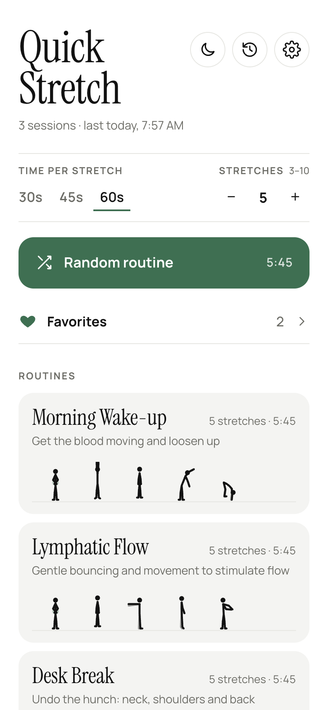    | 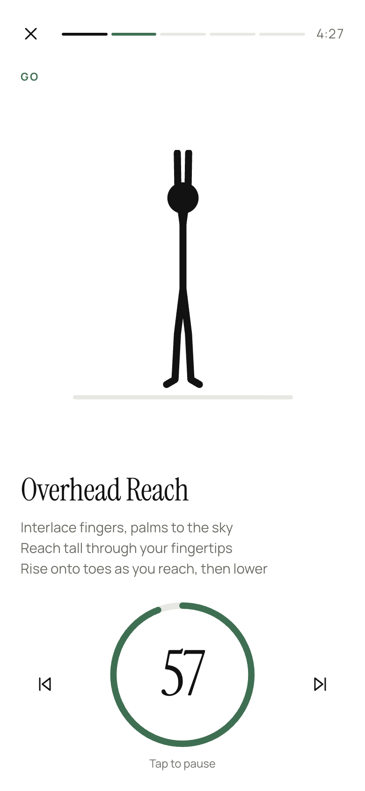    | 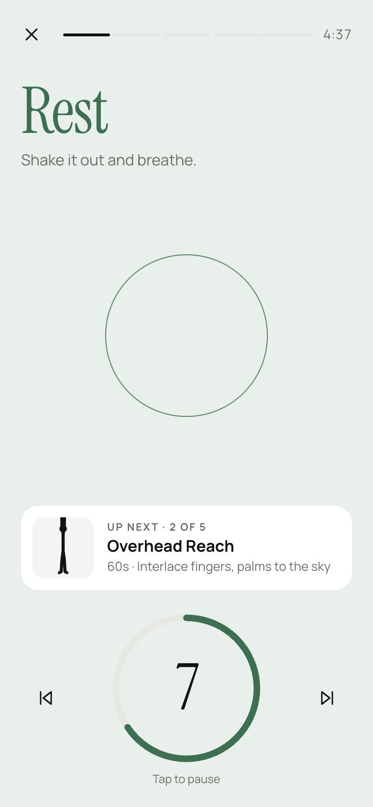    | 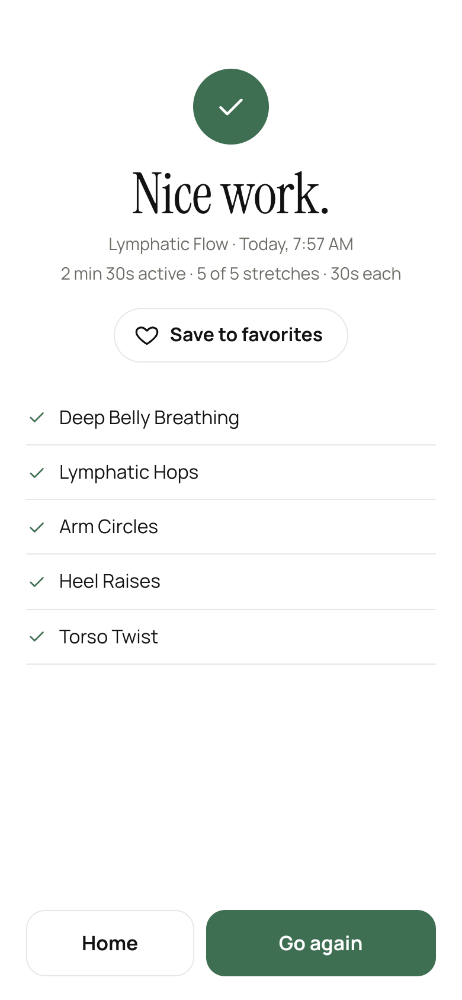    | 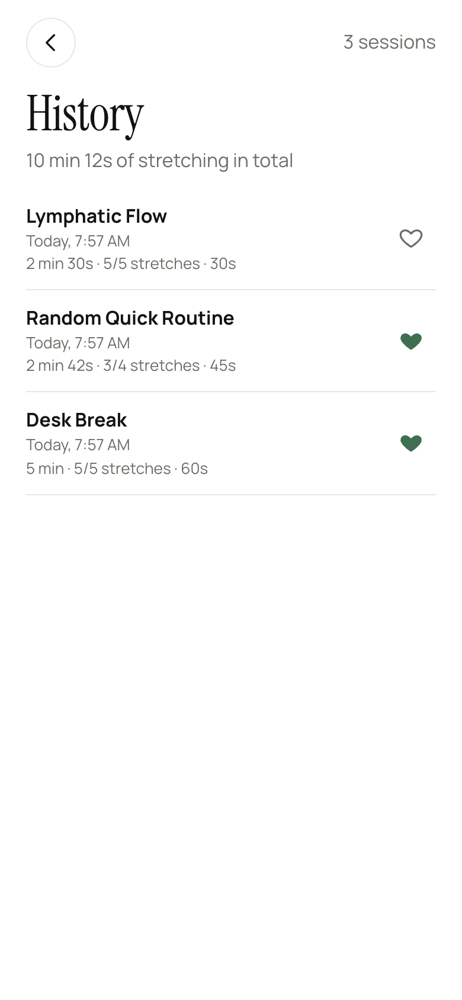    | 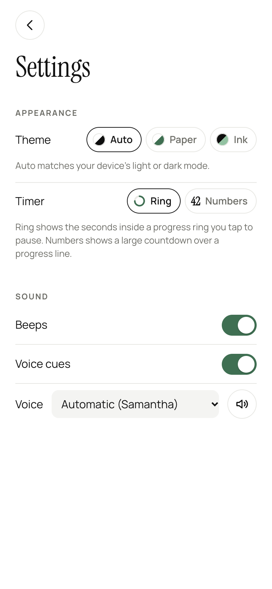    |
| **Ink**   | 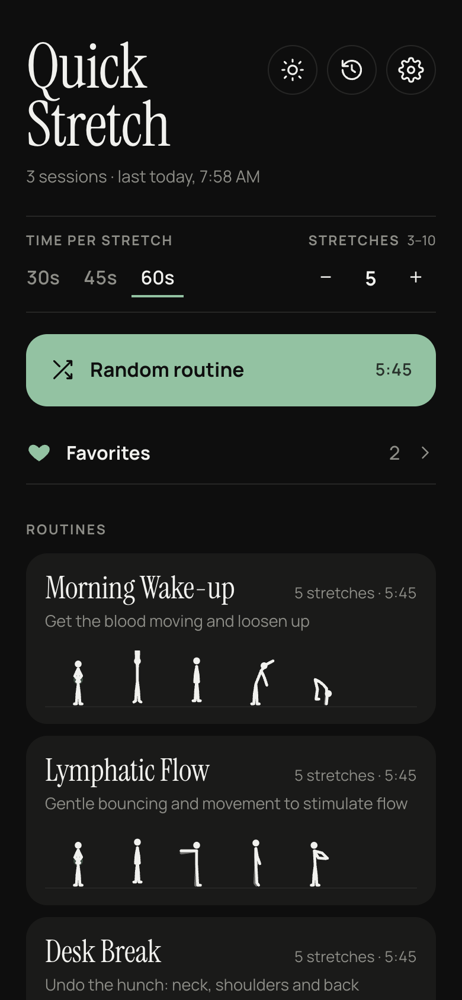 | 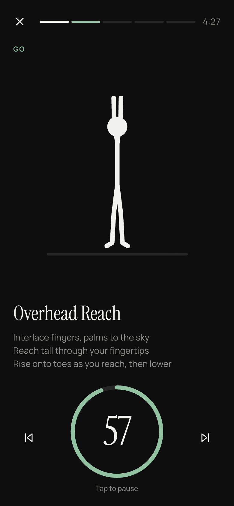 | 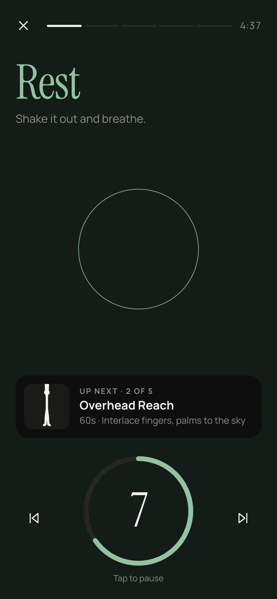 | 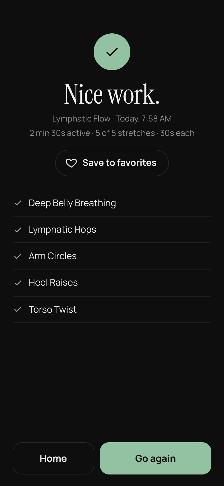 | 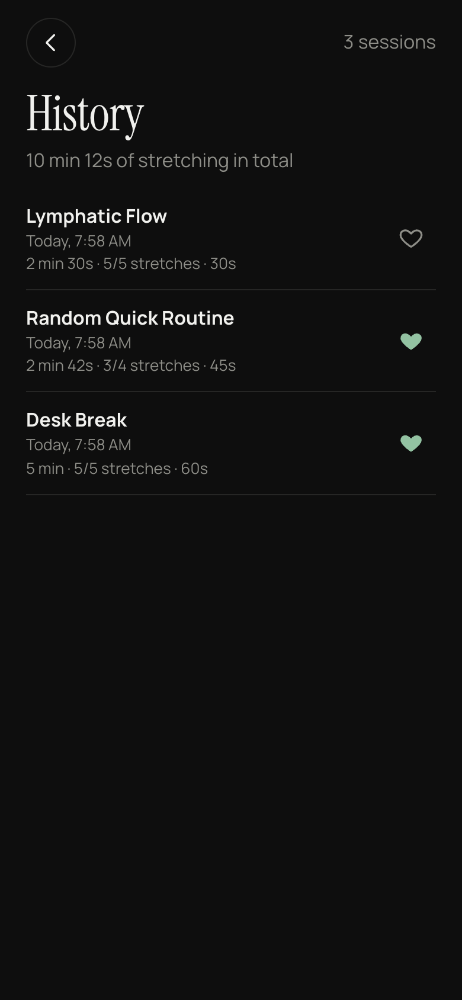 | 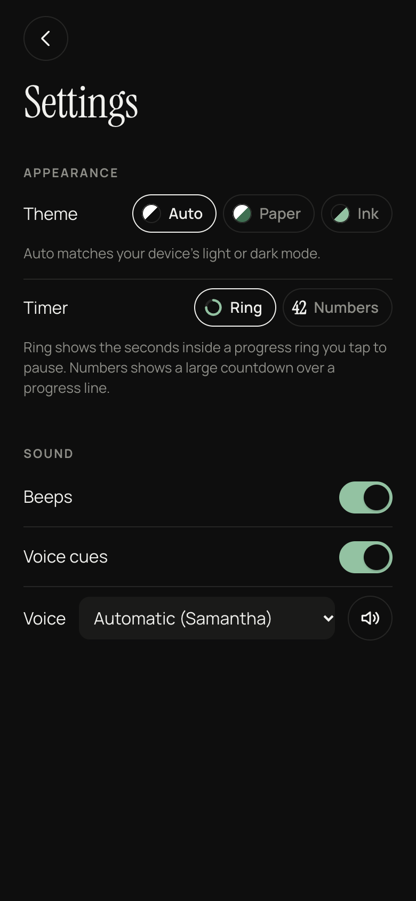 |

## Features

- **Themed routines:** Morning Wake-up, Lymphatic Flow, Desk Break, Hips & Lower Back, Evening Wind-down
- **Random routine** that starts with a gentle move and mixes body areas; Shuffle for a new set
- **Custom session length:** 30, 45 or 60 seconds per stretch and 3–10 stretches (defaults: 60s × 5). Presets keep their opening and closing moves and add or drop on-theme stretches in between
- **Animated stick figures** for 20 exercises, with step-by-step cues; one-sided stretches flip halfway with a "Switch sides" cue
- **Countdown timer** in two styles you choose in Settings: a progress ring with the seconds inside (tap it to pause), or a large number over a progress line. Back and skip buttons, and it stays accurate if you switch apps
- **Get-ready and rest screens** with a breathing pulse and a still "Up next" preview of the next move
- **Audio:** beeps for the last 3 seconds, spoken cues, and a voice picker with a preview button
- **Keeps the screen awake** during a routine
- **History** of finished sessions: date and time, active time, seconds per stretch, and each stretch marked finished or skipped. Each session can be renamed or deleted, or done again
- **Favorites:** heart a session on the completion screen and give it a name; hearted sessions are listed in a Favorites dropdown on Home, where you can rename or replay them exactly
- **Themes:** Paper (light) and Ink (dark) with a sage accent and Instrument Serif headings; choose Auto (match the device), Paper or Ink in Settings, or flip with the sun/moon button on Home
- **Installable and works offline**, with fonts bundled

## Run

```sh
npm install
npm run dev              # http://localhost:7771
npm run dev -- --host    # also reachable from your phone on the same wifi
npm test
npm run build            # static output in dist/
npm run preview          # serve the build on port 7771
npm run screenshots      # retake docs/screenshots (needs the dev server and Chrome)
```

## Install on iPhone

Deploy `dist/` to any HTTPS static host (Vercel, Netlify, GitHub Pages), open it in Safari, then Share → **Add to Home Screen**. It then launches full-screen and works offline.

## Editing content

- Exercises: `src/data/exercises.ts`
- Preset routines: `src/data/presets.ts`
- Stick-figure poses: `src/components/figures/defs.ts`
- Themes: `src/theme/themes.ts`. Add a theme by adding one object to `THEMES` with every colour role filled in; TypeScript rejects a theme with a missing role, and `themes.test.ts` checks its contrast

## Dev shortcuts

These work on the dev server only, not in the built app:

- `#gallery`: every figure's keyframes plus a live animation of each
- `#play`, `#play-rest`, `#play-work`: jump straight into a routine (get-ready screen, the first rest, or the second exercise)
- `#settings`: open the Settings screen
- `#demo`, `#demo-done`, `#demo-history`: fill in sample history and open Home, the completion screen or History

## Notes

- Settings and history are stored in each browser's local storage. They aren't synced between devices or browsers, and clearing site data removes them.
- iOS needs a tap before it allows audio, so sound is unlocked by the **Start** button. The iPhone's silent switch mutes the beeps but not the voice cues.
- Brave's speech engine can get stuck on macOS. If voice cues go quiet there, fully quit Brave (Cmd+Q) and reopen it; Chrome and Safari aren't affected.

## License

[MIT](LICENSE) © 2026 jsfwd
